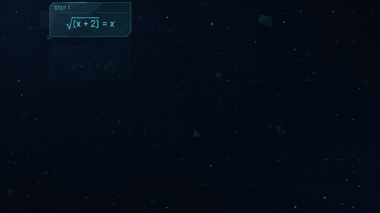

[English](README.md)

# Rozbor chybného řešení

> Online článek a kontext na Vibemaker: [Rozbor chybného řešení](https://vibemaker.cz/clanek/rozbor-chybneho-reseni/)

  

Žák nebo student dohledá první neplatný krok a ověří vlastní opravu na další úloze.

## Použití

Otevřete [český prompt](cs/rozbor-chybneho-reseni.md) a vložte ho do nového chatu. Doplňte požadované vstupy a vyberte režim. Tvorba upravitelného DOCX závisí na nástrojích chatu. Textová náhrada má formu Markdownu.

## Příklad

SŠ: žák řeší √(x + 2) = x a po umocnění zapíše dva kandidáty. Nech ho určit, které musí zkontrolovat a kde.

## Stav a podklady

Textový prompt pro SŠ a VŠ. Chování v konkrétních modelech a tvorbu souborů jsme neověřovali. Podklady zpracovává poskytovatel chatu. Používejte veřejné nebo anonymizované materiály.

## Zdroje inspirace

- [Tutoring Support](https://www.aiforeducation.io/prompts/tutoring-support-from-a-genai-chatbot)
- [Problem-Solving Guide](https://godofprompt.ai/prompt-library/create-problem-solving-guides)
- [Course Mastery Tutor](https://prompts.chat/prompts/cmpvsut1b0001l604a0st68t9_act-as-an-elite-course-mastery-tutor)

## Licence a vydání

[CC0 1.0](LICENSE) pro vlastní prompt a dokumentaci. Změny eviduje [changelog](CHANGELOG.md).

### Autor

**Luděk Sušický**, biolog, středoškolský a vysokoškolský učitel informatických předmětů

- E-mail [ludek.susicky@gmail.com](mailto:ludek.susicky@gmail.com)
- X [@ludeksusicky](https://x.com/ludeksusicky)
- LinkedIn [Luděk Sušický](https://www.linkedin.com/in/ludek-susicky/)
- GitHub [@siberius](https://github.com/siberius)
